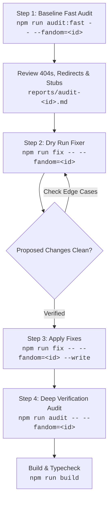

# Multi-Fandom Article Catalog Audit & Remediation Plan

This plan establishes a standardized, automated methodology to audit, resolve 404s/redirects, and ensure consistent puzzle quality across all **12 fandom encyclopedias** in Fandom Redactle.

---

## 1. Catalog Inventory Baseline

| Fandom ID | Display Name | Target Wiki | Source Type | Initial Count | Status |
| :--- | :--- | :--- | :--- | :--- | :--- |
| `atla` | Avatar (ATLA) | `avatar.fandom.com` | Fandom | 289 | ✅ **Completed** (0% 404s, 261 playable) |
| `bbus` | Big Brother (US) | `bigbrother.fandom.com` | Fandom | 206 | ✅ **Completed** (0% 404s, 199 playable) |
| `bbcan` | Big Brother Canada | `bigbrother.fandom.com` | Fandom | 168 | ⏳ Pending Audit |
| `bigbrother` | Big Brother (General) | `bigbrother.fandom.com` | Fandom | 364 | ⏳ Pending Audit |
| `pokemon` | Pokémon | `pokemon.fandom.com` | Fandom | 389 | ⏳ Pending Audit |
| `kingdomhearts` | Kingdom Hearts | `kingdomhearts.fandom.com` | Fandom | 262 | ⏳ Pending Audit |
| `finalfantasy` | Final Fantasy | `finalfantasy.fandom.com` | Fandom | 329 | ⏳ Pending Audit |
| `amazingrace` | The Amazing Race | `amazingrace.fandom.com` | Fandom | 335 | ⏳ Pending Audit |
| `broadway` | Broadway | `en.wikipedia.org` | Wikipedia | 311 | ⏳ Pending Audit |
| `disney` | Disney | `disney.fandom.com` | Fandom | 287 | ⏳ Pending Audit |
| `glee` | Glee | `glee.fandom.com` | Fandom | 317 | ✅ **Completed** (0% 404s, 297 playable) |
| `dragonage` | Dragon Age | `dragonage.fandom.com` | Fandom | 298 | ⏳ Pending Audit |
| **Total** | | | | **~3,558** | |

---

## 2. Standardized 4-Step Remediation Workflow

For every fandom catalog, we execute the following standardized sequence:

### Step 1: Baseline Fast Audit
* **Command:** `npm run audit:fast -- --fandom=<id>`
* **Time:** ~3 to 6 seconds per fandom.
* **Output:** Detects 404 missing pages, disambiguations, and raw byte stubs, generating `reports/audit-<id>.md`.

### Step 2: Auto-Remediation Preview (Dry Run)
* **Command:** `npm run fix -- --fandom=<id>`
* **Logic:**
  1. Resolves canonical targets for redirects.
  2. Queries MediaWiki OpenSearch for 404 titles to find the exact wiki naming.
  3. Detects umbrella sub-topics and duplicate targets to prevent redundant puzzles.

### Step 3: Catalog Writeback
* **Command:** `npm run fix -- --fandom=<id> --write`
* **Output:** Safely edits `src/data/<fandom>Articles.ts`, replacing strings and removing dead/duplicate lines while preserving formatting and category comments.

### Step 4: Verification & Quality Scoring
* **Command:** `npm run audit -- --fandom=<id>`
* **Validation:** Verifies 0% 404s and scores playable depth (word count, prose ratio, lead section, hero image).

---

## 3. Fandom-Specific Considerations

### Reality TV (Big Brother & Amazing Race)
* **Shared Wiki Domain:** `bbus`, `bbcan`, and `bigbrother` all query `bigbrother.fandom.com`.
* **Contestant Disambiguation:** Houseguests and racers frequently have nicknames or shared first names (e.g. *"Rachel Reilly"*, *"Cody Calafiore"*).
* **Season Numbering:** Check for redirects like *"Big Brother 16"* vs *"Big Brother 16 (US)"*.

### Gaming Franchises (Pokémon, FF, KH, Dragon Age)
* **Stats / Moveset Tables:** Pokémon articles often have heavy tabular data. The auditor flags pages where prose ratio is <30%.
* **Recurring Names:** Final Fantasy features repeating tropes across games (e.g. *"Cid"*, *"Chocobo"*, *"Bahamut"*). Must ensure canonical franchise-level or game-specific pages are selected.
* **Kingdom Hearts Title Casing:** Roman numerals and symbols (e.g. *"358/2 Days"*).

### Broadway & Wikipedia Source
* **Wikipedia Backend:** Uses `en.wikipedia.org/w/api.php` instead of Fandom.
* **Parenthetical Disambiguations:** Shows often need disambiguation, e.g. *"Wicked (musical)"* vs *"Wicked"*, *"Hamilton (musical)"*.
* **Composer / Performer Bios:** Highly narrative articles with high prose scores; check for redirect cleanups.

---

## 4. Execution Phases & Milestones

### Phase 1: Reality TV Group (Batch 1)
* [x] `atla` — Avatar (ATLA) *(Completed: 0% 404s, 289 verified entries)*
* [x] `bbus` — Big Brother US *(Completed: 0% 404s, 206 verified entries)*
* [ ] `bbcan` — Big Brother Canada
* [ ] `bigbrother` — Big Brother General
* [ ] `amazingrace` — The Amazing Race

### Phase 2: Gaming Franchises (Batch 2)
* [ ] `pokemon` — Pokémon
* [ ] `kingdomhearts` — Kingdom Hearts
* [ ] `finalfantasy` — Final Fantasy
* [ ] `dragonage` — Dragon Age

### Phase 3: Arts & Entertainment (Batch 3)
* [ ] `broadway` — Broadway (Wikipedia)
* [ ] `disney` — Disney
* [x] `glee` — Glee *(Completed: 0% 404s, 300 verified entries, 297 playable/excellent)*

---

## 5. Quality Acceptance Criteria

For a fandom catalog to be marked complete:
1. **0% Broken/404 Articles:** Every single title must successfully resolve to a live page.
2. **0 Disambiguation Pages:** No disambiguation index pages in the pool.
3. **0 Duplicate Puzzles:** No two entries redirecting to the same canonical article.
4. **Playability Target:** ≥ 85% of articles rated **Playable** or **Excellent** (word count 400–3,500 words, lead paragraph ≥ 30 words).
5. **Clean TypeScript Build:** `npm run build` passes with zero errors.
